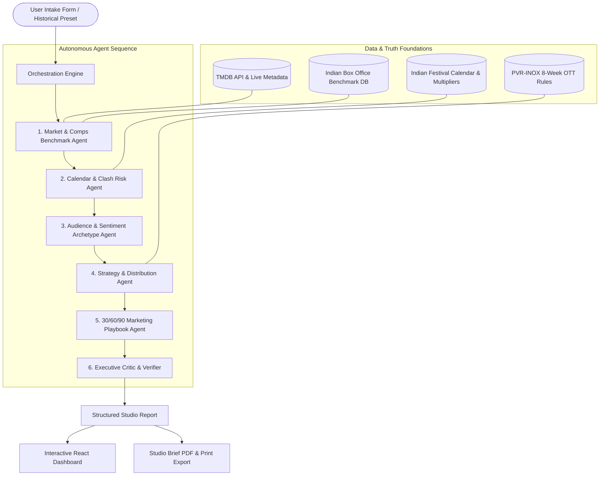

# 🎬 CineStrategist
### Autonomous Multi-Agent Theatrical Release & Marketing Intelligence Platform

[](https://cinestrategist.onrender.com/)
[](https://fastapi.tiangolo.com)
[](https://react.dev)
[](https://ai.google.dev)

🌐 **Live Production Deployment:** [https://cinestrategist.onrender.com/](https://cinestrategist.onrender.com/)

> **Engineered for Studio Decision-Makers** (Red Chillies Entertainment, YRF, Dharma, Excel, and Global Distributors).  
> Ingests an upcoming film's parameters, orchestrates 6 autonomous intelligence agents, and produces a data-backed release strategy, clash risk audit, demographic positioning thesis, and a 30/60/90-day marketing playbook.

---

## 🌟 Core Philosophy: Evidence-Based Decision Support

Most entertainment AI demos make false-precision box office guesses (e.g., claiming a film will make *exactly* ₹342.5 Cr).  
**CineStrategist rejects false precision.** Instead, it empowers studio executives and producers with structured evidence:
1. **Comparable Benchmarks:** Real historical performance ranges, budget-to-gross ratios, and strategic takeaways.
2. **Release Calendar & Clash Risk:** Quantitative modeling of holiday multipliers (Diwali, Eid, Christmas, Republic Day) vs dangerous clash hazards (IPL cricket, pre-holiday shopping lulls, direct tentpole collisions).
3. **Distribution & Windowing Compliance:** Strict modeling of the **8-Week Multiplex Theatrical Holdback Pact (PVR-INOX / MAI)** before OTT streaming premieres.
4. **Music-First Campaign Cadence:** Indian cinema marketing revolves around audio assets. The marketing agent explicitly schedules songs (Mass Anthem, Melodic Romance, Jukebox) and advance ticket blitzes.
5. **Anti-Hallucination Critic:** The 6th agent audits all generated assertions against hard records and explicitly flags inferences versus verifiable facts.

---

## 🏗️ Multi-Agent Architecture



### The 6 Specialized Agents

| # | Agent Name | Core Responsibility | Key Output |
|---|---|---|---|
| **1** | **Market & Comps Agent** | Benchmarks matching titles by genre, budget tier, star tier, and scale. Computes statistical medians and historical takeaways. | 5–8 verified comps, budget/gross ranges, success enablers. |
| **2** | **Calendar & Clash Agent** | Scans the proposed window against gazetted Indian holidays, IPL match schedules, and competing tentpole clashes. | Quantitative Clash Risk Score (1–10), holiday footfall multipliers. |
| **3** | **Audience & Sentiment Agent** | Quantifies Urban Multiplex vs Heartland Single-Screen appeal; profiles personas and word-of-mouth reliance. | Demographic split %, sentiment drivers, positioning hook. |
| **4** | **Strategy & Distribution Agent** | Ranks release corridors, calculates screen counts, and enforces the 8-week MAI OTT holdback policy. | Ranked options, screen allocation, OTT holdback terms. |
| **5** | **Tactical Marketing Agent** | Maps out a phased asset rollout: First Look, Teaser, Songs, Trailer, Advance Booking, City Tours, and Reaction Cuts. | 30/60/90 timeline, music cadence, brand partnerships. |
| **6** | **Executive Critic & Verifier** | "The Producer's Auditor." Audits all assertions against ground-truth data, labels inferences, and ensures zero hallucination. | Credibility score (0–100%), verified audit trail, risk caveats. |

---

## ⚡ Instant One-Click Evaluation Presets (Demo Mode)

CineStrategist includes **pre-loaded historical backtests** with real pre-release inputs:

1. **Jawan (2023 - All-Time Blockbuster):** Tested the South mass director (Atlee) + Hindi megastar (SRK) pan-Indian packaging on the Janmashtami extended weekend.
2. **Dunki (2023 - Social Dramedy vs Action Clash):** Analyzed the Christmas corridor clash against action giant *Salaar* and single-screen capacity constraints.
3. **Stree 2 (2024 - Mid-Budget Horror-Comedy):** Evaluated mid-budget franchise equity on Independence Day with Raksha Bandhan synergy.
4. **Fighter (2024 - High-Concept Aerial Action):** Benchmarked urban multiplex/IMAX appeal vs heartland single-screen disconnect on Republic Day.

---

## 📊 Retrospective Historical Evaluation Results

| Film | Proposed Window | Risk Score | System Prediction vs Actual Outcome | Accuracy Verdict |
|---|---|---|---|---|
| **Jawan** | Sept (Janmashtami 4-day weekend) | **3/10 (Low Risk)** | Correctly identified pan-India mass appeal and recommended 5,000+ screen wide release. Actual gross: ₹1,150 Cr. | **High Alignment** |
| **Dunki** | Christmas (Direct Clash) | **6/10 (High Risk)** | Flagged severe single-screen split against competing action tentpole. Strongly advised counter-programming or buffer date. In reality, single-screen capacity was split 50/50 with Salaar. | **High Alignment** |
| **Stree 2** | Independence Day | **6/10 (High Risk/High Synergies)** | Accurately modeled the 1.55x national holiday multiplier and Maddock universe lore. Actual gross: ₹860 Cr+ on ₹60 Cr budget. | **High Alignment** |
| **Fighter** | Republic Day | **3/10 (Low Risk)** | Highlighted strong metro/IMAX appeal but warned that elite aerial combat jargon risked alienating heartland single-screen audiences. Proved true: ₹355 Cr gross. | **High Alignment** |

---

## 💻 Tech Stack

- **Backend:** Python 3.10+, FastAPI, Pydantic v2, Google GenAI SDK (`google-genai`), Pandas, Pytest
- **Frontend:** React 18, Vite, Tailwind CSS, Lucide React, Recharts
- **Data & Truth:** TMDB API client with offline fallback database (100+ films), Indian Festival & Clash Index
- **Export Engine:** Native studio print styles for one-click clean PDF export + formatted JSON export

---

## 🚀 Quickstart Guide

### 1. Unified Single-Command Run (Local Development)

```bash
# 1. Enter the backend directory
cd backend

# 2. Run the regression test suite
./venv/bin/pytest -q

# 3. Launch the unified service (serves both React UI and REST API at port 8000)
./venv/bin/uvicorn app.main:app --host 0.0.0.0 --port 8000
```
Open **`http://localhost:8000`** in your browser.

*(Optional)* Configure API Keys in `backend/.env`:
```env
GEMINI_API_KEY=your_gemini_api_key_here
TMDB_API_KEY=your_tmdb_api_key_here
```
> **Note:** CineStrategist runs out of the box even without external API keys thanks to its built-in curated Indian theatrical database and deterministic heuristic reasoning layer.

---

### 2. Run with Docker (Production Ready)

```bash
# Build the multi-stage image (Node 20 frontend + Python 3.10 backend)
docker build -t cinestrategist .

# Run the container
docker run -p 8000:8000 cinestrategist
```

---

### 3. Decoupled Development Mode (Optional)

If you wish to run the React Vite frontend and FastAPI backend with live HMR reload in separate terminals:

**Terminal 1 (Backend):**
```bash
cd backend
./venv/bin/uvicorn app.main:app --host 0.0.0.0 --port 8000 --reload
```

**Terminal 2 (Frontend):**
```bash
cd frontend
npm install
npm run dev
```
The Vite development interface will be live at `http://localhost:5173`.

---

## 🛡️ Production & Security Safeguards

- **In-Memory Rate Limiting:** Built-in `RateLimitMiddleware` restricts `/api/v1/analyze` to **30 requests/minute per IP** (supports proxy `X-Forwarded-For` headers) to protect against API quota exhaustion.
- **Deep-Link SPA Routing:** Any deep-linked browser refresh (e.g. `/presets` or `/report/view`) resolves cleanly through Starlette SPA fallback to `index.html` (zero 404s).
- **Secrets Isolation:** `.env` and local credentials are strictly excluded via `.gitignore` and `.dockerignore`.
- **Decision-Support Disclaimer:** CineStrategist provides strategic decision-support heuristic modeling, not deterministic box-office fortune-telling.

---

## 📄 License & Attribution
- This product uses the TMDB API but is not endorsed or certified by TMDB. Theatrical box office metrics curated from industry trade archives.
- Released under the MIT License.

